<!-- TITLE PAGE -->

# M3

## User Manual

Version 1.0.8

<!-- END TITLE PAGE -->

PatchGrid is a performance-oriented patch organizer for the Korg M3. It presents patches as a 4 x 4 grid so you can select sounds quickly, arrange them into pages, and adjust useful performance controls from one screen.

This manual describes the PatchGrid interface and workflows implemented in the PatchGrid view.

## Contents

- Feature summary
- Disclaimer
- The PatchGrid Boot screen
- Before you begin
- The PatchGrid screen
- Play mode
- Search
- Edit mode
- Settings
  - Library / Assign
  - Global
- Saving and persistence
- Troubleshooting
- Quick reference
- Appendix A: Background Midi (iOS 26 or later)

## Feature summary

### Launch and layout

- Instant patch launch from a visual 4 x 4 slot grid
- Multi-page PatchGrids for larger sound sets
- Re-orderable PatchGrids and pages with independent reorder modes
- One-touch selection sends the chosen patch directly to the M3
- Dedicated Play view for quick access during performance
- Dedicated Edit view for building and managing PatchGrids
- Slot-grid drag can be locked or unlocked from the Play view
- Template PatchGrids can be filled from enabled M3 banks
- Play-view patch search is available from the search icon

### Sounds and storage

- Stores both PROG and COMBI patches in the same PatchGrid workflow
- Up to 16 slots per page
- Up to 8 pages per PatchGrid
- Up to 128 saved PatchGrids
- Default PatchGrid auto-populates starter sounds from PROG and COMBI categories
- Default PatchGrid includes starter notes explaining its sample sounds

### Per-slot control

- Per-page, per-patch performance-control overrides
- Saved slot controls include Tempo, Volume, EQ, Transpose, SW1, SW2, Drum Track, and KARMA
- 16 slot colours with Auto Colour and quick two-tap colour selection
- Patch search for assigning sounds to slots

### Editing and management

- PatchGrid naming with duplicate-name protection and input validation
- Rename, duplicate, clear, and hide PatchGrids
- Duplicate PatchGrids with all pages and slot data under a new name
- Duplicate and clear individual pages
- Copy and paste single slots between positions
- Remembers the last selected page and slot when reloaded

## Disclaimer

Stringline Productions takes no responsibility financially or otherwise for any data loss or device malfunction that may occur by using this product. This product has no affiliation with or endorsement from Korg Inc. The manual may not show the exact product images, but it is regularly updated to match the latest versions of the app. Any queries regarding this app must be directed to Stringline Productions.

## Before you begin

PatchGrid supports direct USB-wired MIDI and Bluetooth MIDI connections between the iPad and the Korg M3. Apple Network MIDI, RTP-MIDI, Wi-Fi MIDI, and other network connection methods are not supported. Network MIDI ports may still appear in the MIDI selectors; do not select them for the M3 connection.

PatchGrid needs the M3 patch data to be loaded before its patch browser is complete. Connect and select the MIDI input and output used by the M3, then allow the app to finish loading. If the patch data is still loading, the grid may initially show its shell without all patch names.

Patch selection sends the selected patch to the configured M3 MIDI output. If no suitable MIDI output is selected, the interface can still be edited, but the M3 will not respond.

## The PatchGrid Boot screen

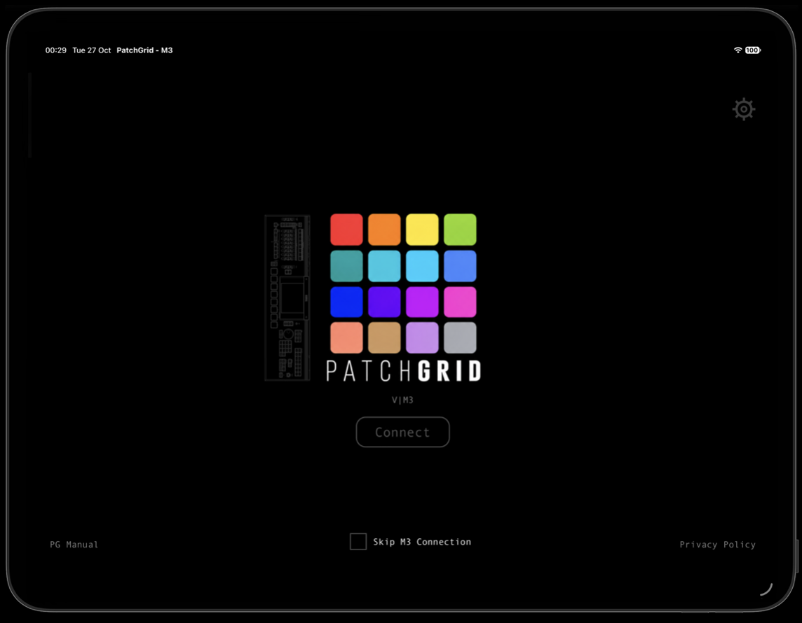

The Boot screen is the first screen used to prepare PatchGrid. It detects the connected M3 and supported expansion boards, loads the available patch data, and provides the MIDI connection controls.

The **Keyboard** selector can be used to choose from the available MIDI inputs, including multiple connected keyboard inputs. **M3 Input** selects the MIDI input used to receive data from the M3, and **M3 Output** selects the MIDI output used to send patches and controls to the M3. Select the supported direct USB or Bluetooth M3 ports only: Apple Network MIDI and RTP-MIDI ports are not supported, even if they appear in these lists. Use **Connect** after selecting the required devices.

Select **Skip M3 Connection** when you want to use PatchGrid without connecting to an M3. PatchGrid remains available for offline editing, browsing, and organizing patches; the M3 will not receive patch changes until a connection is made.

The **Inventory** text button switches the visible patch inventory between patches imported from the M3 and the preset patches supplied with PatchGrid. Use it to confirm which patch source is being displayed before assigning sounds.

The **Privacy Policy** and **PG Manual** text links open the product privacy information and this user manual.

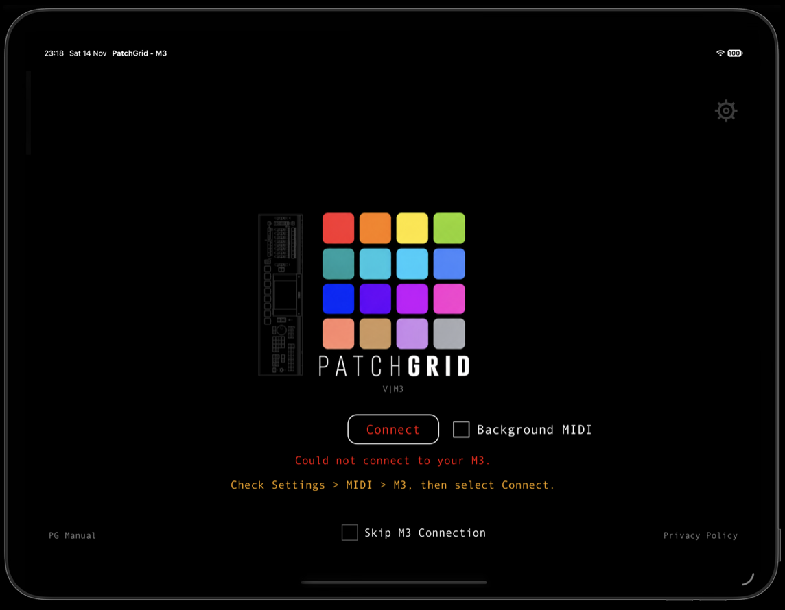

If the M3 or a virtual M3 device is not detected, the Boot screen reports the connection failure. Select the MIDI devices and choose **Connect** to try again, or select **Skip M3 Connection** to continue in offline mode.

## The PatchGrid screen

The left side of the screen contains the mode buttons:

- **Play** (Play symbol): select and perform patches.
- **Edit** (Grid icon): assign patches, manage PatchGrids and pages, edit notes, and adjust slot settings.
- **Settings** (Gear icon): open MIDI, Config, Import, and Patch tools.

The header shows the selected patch name and the notes for the current PatchGrid. The centre of the Play view is a 4 x 4 grid containing 16 slots. A slot can contain a Program, a Combination, or be empty.

The PatchGrid selector lets you move among saved PatchGrids. Page arrows move among the pages in the current PatchGrid. Each PatchGrid can contain up to 8 pages, and each page contains 16 slots. The application supports up to 128 saved PatchGrids.

### Play view at a glance

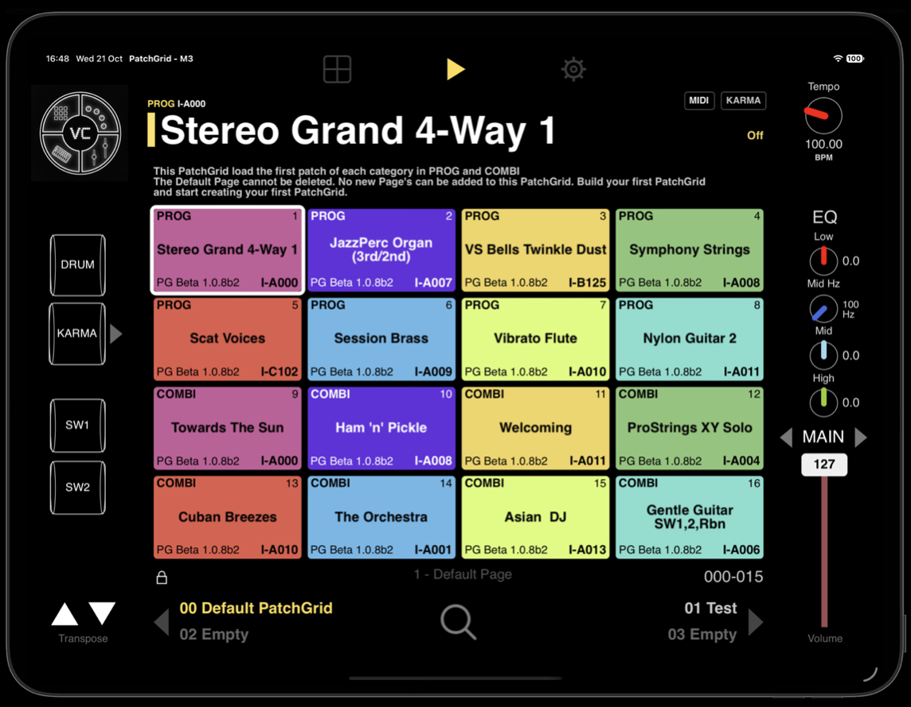

The Play view is designed for live selection: the large coloured slots are the patches in the current page, the selected patch is shown in the header, and the controls around the grid provide quick performance changes. The MAIN, VOL, slider, and EQ controls sit lower in the view; DRUM, KARMA, SW1, and SW2 are repositioned on the left; and the transpose controls sit farther right. The VC logo is visible in Play mode and hidden in Edit mode. The PatchGrid selector uses a 2 x 2 layout, with its previous and next arrows kept within the selector width.

The search icon is in the Play view header. Use it to search loaded patch names or patch numbers, filter results by patch type or bank, preview a result, and assign it to the selected slot.

## Play mode

### Select a patch

1. Click the **Play** symbol.
2. Click a filled slot in the 4 x 4 grid.
3. PatchGrid selects the slot and sends the corresponding bank and program change to the M3.

Click an empty slot to select it. In Play mode, drag it through the available patches to populate it, or use Edit mode when you want to browse and assign a specific patch.

### Change page or PatchGrid

- Use the left and right arrows beside the grid to change page.
- Use the PatchGrid selector arrows to move through saved PatchGrids.
- Select a PatchGrid entry to load it.
- In Edit mode, tap the combined reorder icon beside **PatchGrid** to turn PatchGrid reorder mode on or off.
- Use the **Pages** reorder icon separately when you want to reorder pages.

When a reorder mode is on, its icon is yellow and remains active until tapped again. Drag the selected PatchGrid or page to reorder it; the insertion marker shows whether it will be placed above or below the target row. When reorder mode is off, dragging the list scrolls it. PatchGrid and page reordering are independent, and the order is saved and restored after the app restarts. The first page is displayed to users as Page 1. The first page of the built-in Default PatchGrid cannot be deleted or cleared, and its next-page arrow is hidden when no next page is available.

The slot-grid lock icon is at the bottom-left of the grid. Tap the lock to unlock slot dragging, then move slots to different positions within the current PatchGrid page. Tap the icon again to lock the grid and prevent accidental movement.

Template PatchGrids are created from the enabled INT and USR banks in **Settings > Config > Grid/Pages**. Each enabled bank supplies a PatchGrid page pre-filled with patches from the loaded M3 patch list. The **Template** control in Play mode selects the generated template view.

### Performance controls

The selected slot exposes these controls in Play mode:

- **Drum**: toggle the drum track.
- **KARMA On/Off**: toggle KARMA.
- **SW1** and **SW2**: toggle the M3 switches.
- **TRANSPOSE**: use the up and down buttons to change transpose from -12 to +12 semitones.

The selected slot's tempo and volume controls are also available on the performance panel. Drag rotary controls vertically to change their values, and drag the volume slider vertically. Changes are sent to the M3.

### Bi-directional M3 control

When PatchGrid is connected through the selected **M3 Input** and **M3 Output** ports, supported changes can travel in both directions. Changes made in PatchGrid are sent to the M3. Changes made on the M3 to Tempo, Drum Track, KARMA, SW1, SW2, and Program or Drum Track EQ are immediately reflected in the controls displayed for the selected PatchGrid slot. Program and Drum Track EQ synchronization applies to PROG patches.

M3-originated control changes are shown as live values. They are not sent back to the M3 and are not automatically saved as slot overrides. Use **Save** on a normal PatchGrid page when you want to retain the current supported performance-control values for that patch and page.

PatchGrid also recognizes patch selections made on the M3. It uses the M3 mode to distinguish a PROG from a COMBI, then matches the bank and program number against the loaded patch information. When a match is found, the selected PatchGrid slot immediately displays that patch and its type. If the selection cannot be matched, the current slot remains unchanged.

### Modal popups

Play mode provides larger modal controls for Tempo and KARMA. A modal temporarily covers the slot grid so the selected control can be adjusted directly.

#### Tempo popup

Tap the displayed tempo value to open the Tempo popup. It starts with the selected slot's current tempo and supports values from 40.00 to 300.00 BPM.

Choose the keypad icon to enter a tempo directly, including a decimal value, then tap **Set** to apply it. Choose the encoder icon to adjust the value with a rotary drag, then tap **Set**. The pink arrows change the tempo by 1 BPM and the blue arrows fine-tune it by 0.01 BPM.

Enable **Presets** to show the supplied tempo choices: **Slow 60**, **Medium Slow 80**, **Medium 100**, **Fast 130**, and **Very Fast 145** BPM. Selecting a preset applies it immediately. Tap outside the popup, press Escape, or move focus away to close it without applying an unfinished keypad or encoder value.

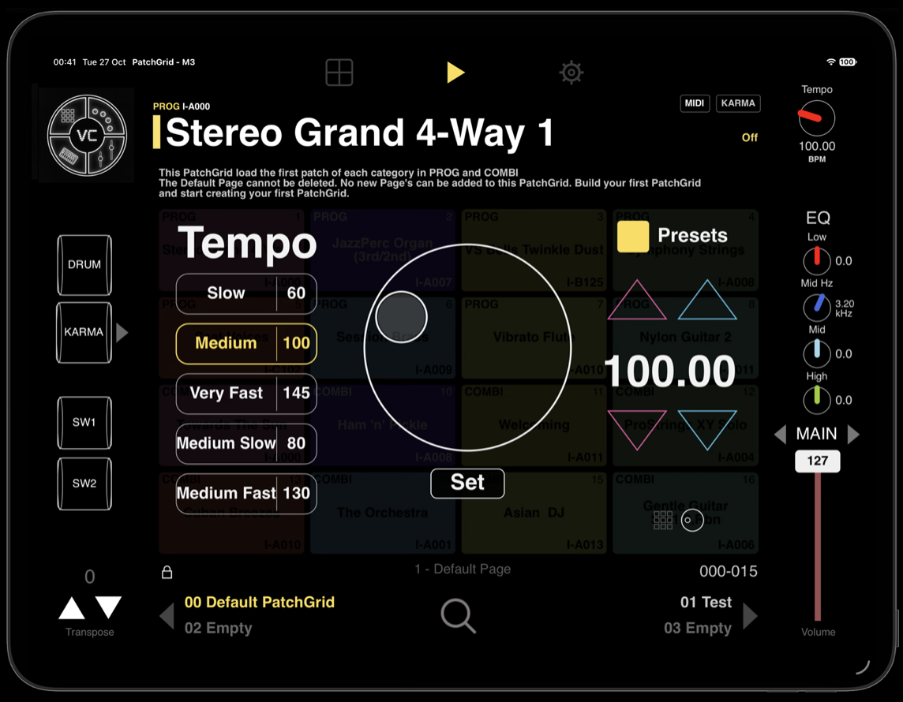

The Encoder view provides rotary tempo adjustment, whole-number and 0.01 BPM fine-tuning arrows, Presets, and Set.

#### KARMA Controls popup

Tap the small arrow beside **KARMA On/Off** to open the KARMA Controls popup. Use **KARMA Link** to link Drum Track operation to KARMA, and use **Latch** to switch KARMA Latch on or off.

For a COMBI, direct Module buttons select **M**, **A**, **B**, **C**, or **D**. A PROG uses the master module only. Direct Scene buttons select Scene 1 through Scene 8. The Module and Scene previous and next arrows step through the available values and wrap at the ends.

Use the Module or Scene **Reset** control to restore that original value. The main **Reset** restores the patch's original KARMA On/Off, Link, Latch, Module, and Scene settings. Tap outside the popup to close it. The KARMA On/Off control remains available while the popup is open.

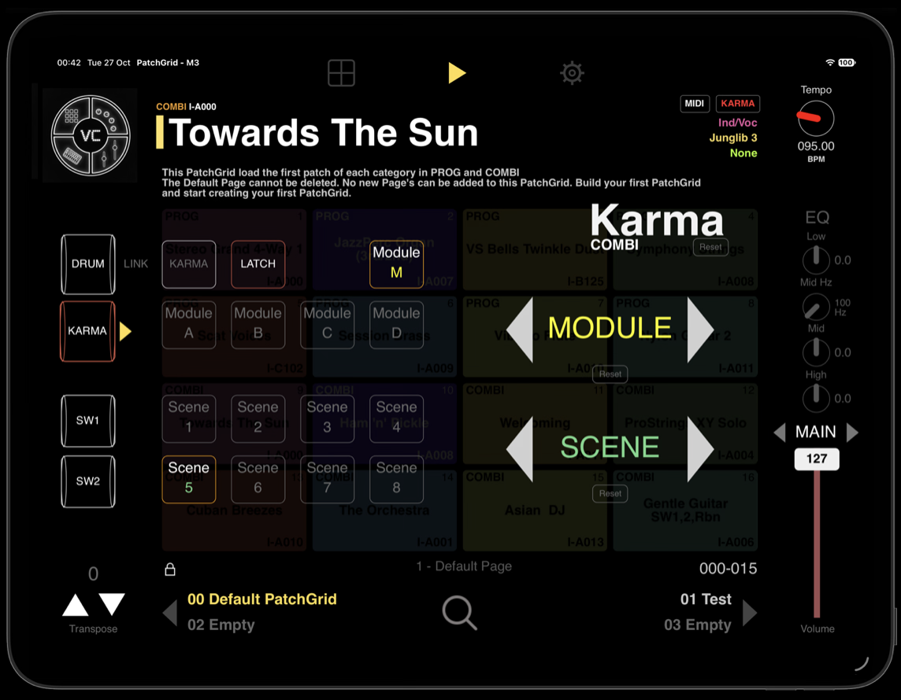

The COMBI popup provides direct Master, Module A-D, Latch, Link, and Scene 1-8 controls, plus previous, next, and Reset controls.

On a normal PatchGrid page, use **Save** to store the current performance-control values for the selected patch on that page. When that patch is loaded again, its saved controls are restored and sent to the M3, and **Save** is highlighted. Tap the highlighted **Save** button to remove only that patch's saved controls for the current page and return to the patch's normal controls. **Save** is not available for the protected Default PatchGrid.

In Play mode, press and drag a filled slot to change its patch. A horizontal drag moves through patch numbers in the current bank, while a vertical drag moves through the available patch categories in that bank. Both directions wrap at the end. During the drag, the selected slot shows the previous, current, and next patch names; the preview disappears when the drag ends and the selected patch is saved.

To fill an empty slot by dragging through patches, start a straight drag on the empty slot and continue through the available patch selection. The selected slot changes as the drag continues and the final selection is saved when the drag ends.

The **MIDI Status Strip** initially shows **MIDI**. Tap it to expand the active message groups: **SYSEX**, **PC**, **CC**, **BANK**, and **NOTE**. Tap it again to collapse the strip. The **KARMA Status Strip** initially shows **KARMA**; tap it to show **LATCH** or **OFF**, the active module (**MST**, **A**, **B**, **C**, or **D**), and the scene (**S1** through **S8**). Both strips reflect the selected slot and provide status at a glance.

When the selected PROG or COMBI contains drum-track data, Play mode shows the drum pattern category, drum pattern, and drum kit above the performance controls. PatchGrid resolves these names from the loaded M3 MIDI dump and its drum pattern and drum kit lookups. Empty or unmatched drum-track data leaves the corresponding information empty.

The Play header can show the selected patch, MIDI status, KARMA status, and drum information together. The MIDI strip expands to show SYSEX, PC, CC, BANK, and NOTE activity. The KARMA strip shows its current state, module, and scene.

## Search

Open **Search** using the magnifying-glass icon in the centre of the PatchGrid selector in Play view. Wait for patch loading to complete first. Search uses the loaded patch catalogue; hearing a result requires a connected instrument. The keyboard stays hidden until you tap the search field.

### Target slots, colours, and closing Search

- **Mini PatchGrid:** tap a slot in the small 4 x 4 grid to choose the assignment target. This preserves the selected result and its Patch Card; choosing a different target alone does not assign the preview.
- **Target pages:** use the mini-grid page arrows, when available, to target another existing page without closing Search or losing the selected preview.
- **Slot colours:** tap the same mini-grid target again to cycle its colour. The colour change is saved.
- **Search Link:** tap the padlock beside the patch-name area to switch between immediate assignment and preview-only result selection. Performance controls remain available while Search is open.
- **Result limit:** up to 4,096 matches are returned. Narrow the text or filters when you need a smaller set.
- **Close:** in landscape, tap outside the Search area or press Escape. Closing clears the search text, filters, and preview; it does not undo assignments or colour changes already saved. Dismissing the on-screen keyboard alone leaves Search open.
- **Portrait layout:** Search is integrated into Play view. **Find** locates the selected slot's patch in Search; **Update** assigns the preview to the selected slot. Use the Edit header to leave the portrait Search workflow rather than expecting landscape dismissal.

### Text search

Tap the **Search** field and enter a patch name, part of a name, or a bank/patch number such as **I-B050**. Results update as you type. Searches ignore letter case; name searches treat punctuation as word separators. Multiple search words can match in any order, including the starts of words. Exact patch numbers and closer name matches appear before less exact matches within each patch-type group.

The field accepts up to 64 printable English letters, numbers, spaces, and punctuation characters. The result strip shows **PROG**, **COMBI**, **GM**, **VAR**, and **DRUMS** counts. Tap a group to show only that type; tap it again to remove that result-type filter. Scroll longer lists by dragging, using the scrollbar, or using a mouse wheel.

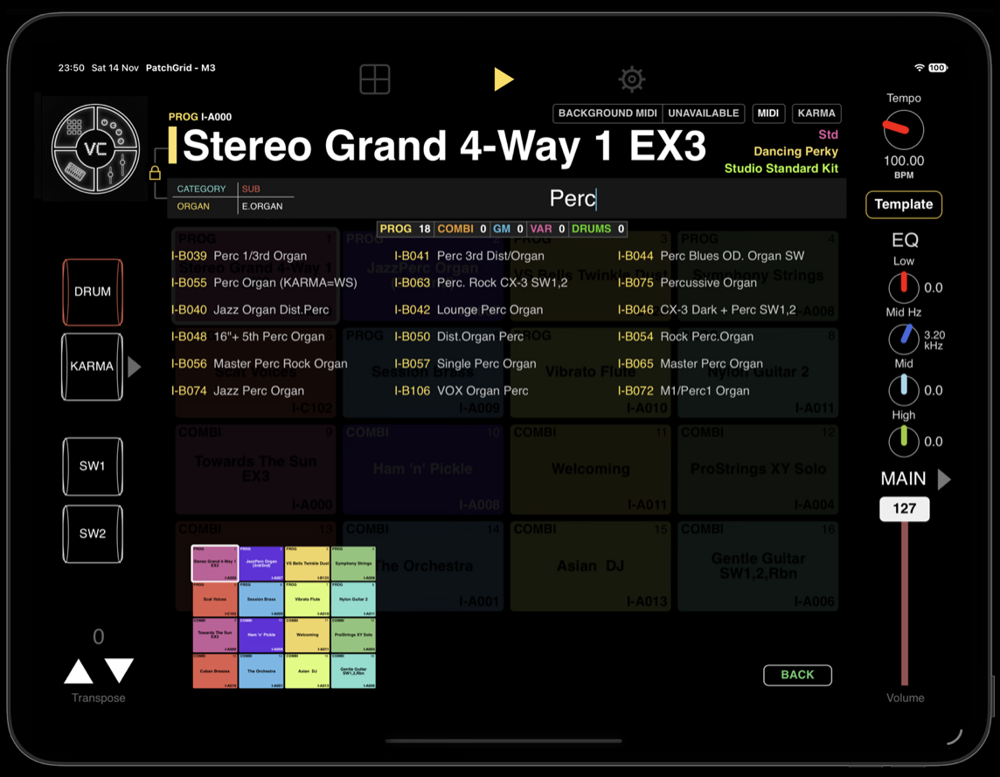

Text search. The example searches for Perc within the selected Organ / E.Organ category and sub-category.

### Search filters

Choose **PROG** or **COMBI**, then **BANK** or **CATEGORY**. BANK offers the available Internal and User banks. PROG bank filtering also includes **GM**, variations **g(1)** to **g(9)**, and **g(d)** for GM drums. **INT-F** cannot be selected for PROG when no RADIAS board is detected.

CATEGORY lets you choose a category and then a sub-category. Tap a selected bank, category, or sub-category again to deselect it. Changing patch type or switching BANK/CATEGORY clears the previous filter selection. **CLEAR** removes the bank/category selections.

Tap **SEARCH** to show matches, with or without text. Text and selected filters work together. The search bar summarises the active bank or category/sub-category. Tap that summary, or **BACK** in the results view, to return to the filter controls.

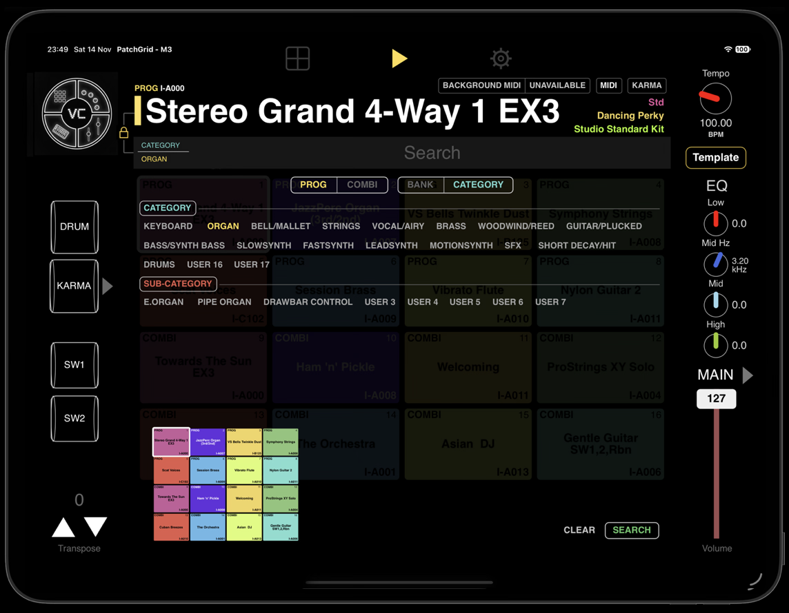

Search filters. Choose a patch type and bank or category; this example selects PROG and the Organ category.

### Search selection and slot assignment

Tap a result to show its **Patch Card** and information: name, type, category, sub-category, source, and patch number. Source can be User, Preset, or Unknown. The selected result is outlined.

**Check the Search Link padlock before selecting a result.** With the link locked, tapping a result immediately assigns it to the target slot, saves the change, and sends the patch selection to the connected instrument. With the link unlocked, tapping a result changes only the preview and sends no MIDI selection. Tap the large Patch Card to assign the preview to the target slot and send the selection. Search remains open so you can continue selecting sounds.

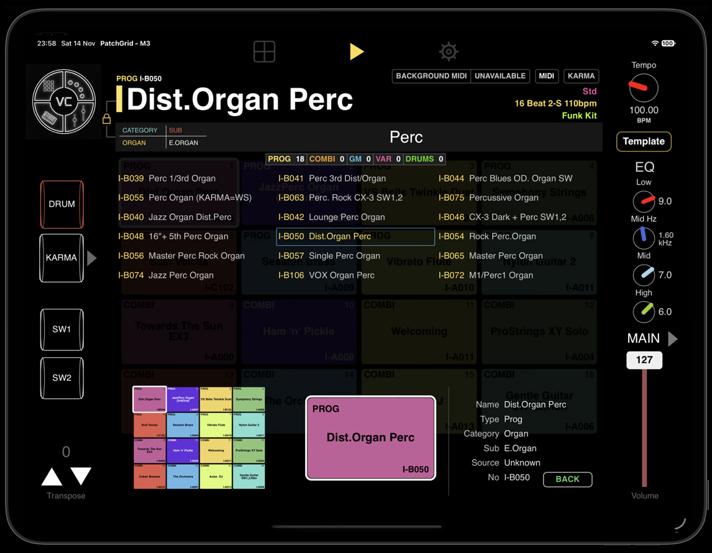

Selection and assignment. I-B050 Dist.Organ Perc is selected; its Patch Card, patch information, and mini-grid target are shown.

## Edit mode

Click **Edit** to open the editor. The Edit view is for managing PatchGrids and pages, editing notes, selecting slots, and reviewing the Grid Table. Patch assignment and detailed performance controls are handled from the Play view and Settings.

### Edit view at a glance

The Edit view brings PatchGrid management, page management, notes, the grid preview, and the Grid Table onto one screen. Select a PatchGrid and page on the left, then select a slot in the preview or table.

The selected slot has a thicker outline so it remains easy to identify in the preview. The VC logo is hidden in Edit mode to leave more space for editing controls.

### Grid Table view

Grid Table shows the 16 slots as rows. It is useful when you need to compare patch type, bank and number, tempo, volume, EQ values, Drum, KARMA, SW1, SW2, and colour without opening each slot separately.

### Edit notes

1. In Edit mode, click the notes area in the header.
2. Type or replace the notes. Notes are limited to 500 characters; the remaining-character counter shows how much space is available.
3. Click **Save** to keep the new notes, or **Cancel** to restore the previous text.

Pressing Escape cancels an active notes edit. Clicking away from the editor does not save the text by itself.

The notes area is scrollable when the text is longer than the visible field. A new Default PatchGrid starts with these notes: “This patch grids load the first of each category in PROG and COMBI to give you some options to try out the sounds.”

### Create a PatchGrid

1. Open **Edit**.
2. Click **New** beside the Patch Grids list.
3. Enter a name.
4. Press Return or click **Add** to confirm.
5. Assign patches and configure the pages.

Names must be non-empty, unique, and no longer than 23 characters. The name **Default PatchGrid** is reserved. Escape or **Exit** cancels creation without creating a file.

### Rename a PatchGrid

1. Select the PatchGrid in Edit mode.
2. Click **Rename** or the pencil icon.
3. Edit the name.
4. Press Return or click **Add** to confirm.

An invalid, duplicate, empty, or reserved name is rejected and leaves the existing name unchanged.

### Add, duplicate, clear, or delete a page

Use the **Pages** panel in Edit mode:

- **New** adds a blank page, up to the eight-page limit.
- **Duplicate** inserts a copy of the current page.
- **Clear** removes all slot assignments and settings from the current page.
- The trash button deletes the current page after a second confirmation click.
- Tap the combined reorder icon beside **Pages** to turn page reorder mode on or off, then drag the selected page. The insertion marker shows where it will be placed. The mode remains active until tapped again.

Page 1 cannot be deleted. The first page of the Default PatchGrid also cannot be cleared. The Default PatchGrid cannot receive additional pages; its next-page arrow is hidden. When an action is blocked, the app warns: “The Default Page cannot be deleted. No new Page's can be added to this PatchGrid.”

### Clear, duplicate, or delete a PatchGrid

Use the Patch Grids panel in Edit mode:

- **Clear** removes the assignments and settings from the selected PatchGrid.
- **Duplicate** asks for a new unique name, then creates an ordinary PatchGrid containing a copy of every page and its slot data.
- The trash button requires a second confirmation click before the PatchGrid is hidden and removed from the list.

The built-in Default PatchGrid cannot be cleared or deleted.

### Copy and paste slots

For a single slot:

1. Select the source slot.
2. Click **Copy**.
3. Click the target slot.

The patch, controls, and colour are pasted together. Click **Copy** again while copy mode is active to cancel it.

## Settings

The **Settings** item is represented by the Gear icon. It contains MIDI, configuration, import, and patch-library workflows.

### MIDI settings

#### M3 Midi connection

Open **Settings > MIDI > M3** to choose the MIDI input and output used for communication with the Korg M3.

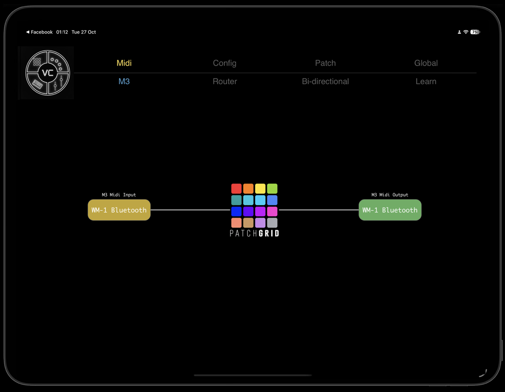

M3 Midi connection. The selected M3 MIDI input and output connect PatchGrid to the instrument.

#### Router

Use **Router** to add PatchGrid MIDI inputs and outputs. Connect input rows to output rows to create MIDI routing, then configure channel and filtering options for each route. The port view supports multiple input and output rows.

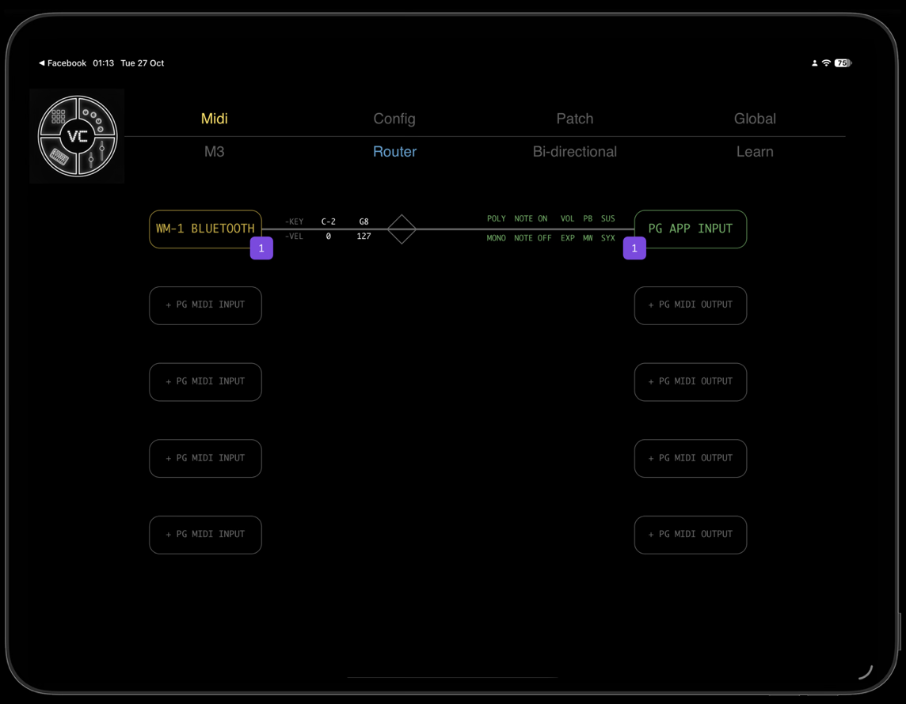

MIDI Router. This example routes WM-1 Bluetooth to PG App Input.

#### Bi-directional

Use **Bi-directional** to choose which messages received from the M3 are allowed to update PatchGrid. The available groups are **Drum** (On/Off, Pattern, and Kit), **KARMA** (On/Off, Latch On/Off, Drum Link, Module, and Scene), and **Patch** (Select). Each message can be enabled or disabled independently.

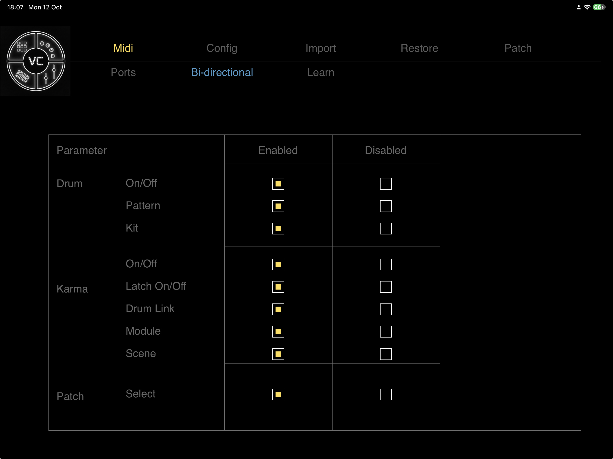

#### Learn

Use **Learn** to assign MIDI controls to PatchGrid parameters. The learnable parameters include **Volume**, **EQ**, **Switch**, **Transpose**, **Slot**, **KARMA**, **Module**, **Scene**, **PatchGrid**, **PatchList**, and **Mode**. Select a parameter and send the MIDI message you want to use; the assigned message is shown in the CC column.

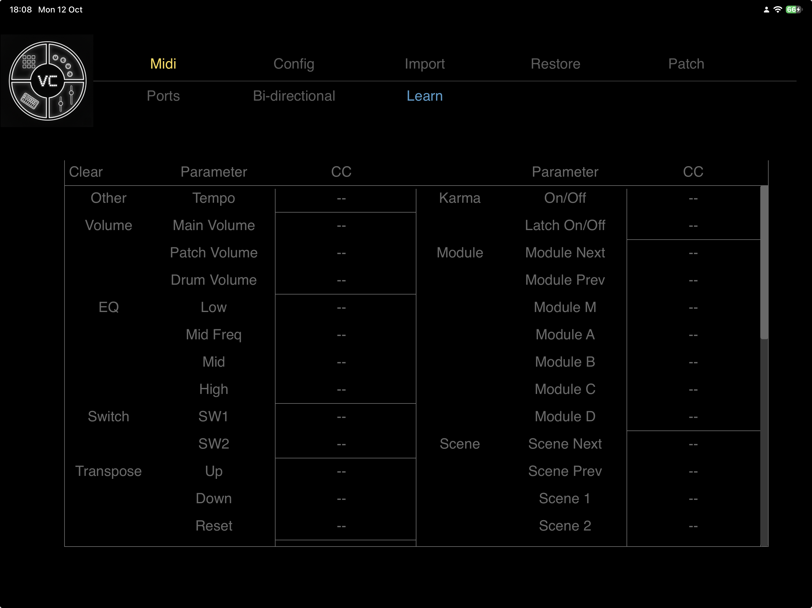

### Config settings

#### General

**Backup** can be enabled and configured with an interval, retention period, and minimum number of backups. **Export** writes the application data to a selected `app.json` path.

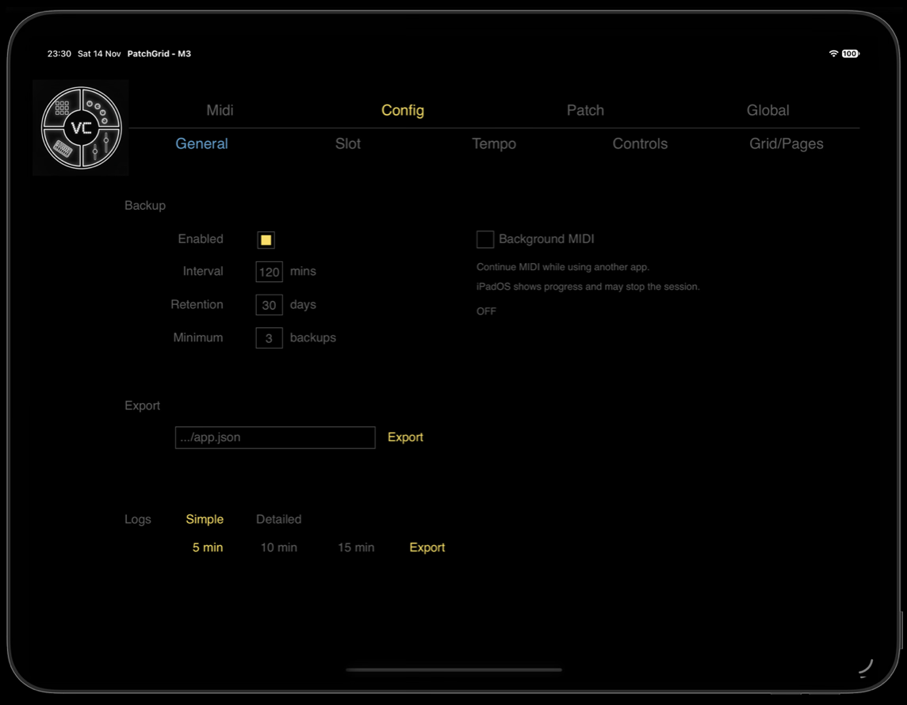

#### Slot

**Slot** contains the 4 x 4 grid setup, the slot colour palette, gesture settings, and **Slot Drag**. Enable Slot Drag when you want to change a slot's patch by dragging in Play mode. The gesture controls define whether vertical movement changes category and horizontal movement changes bank patch.

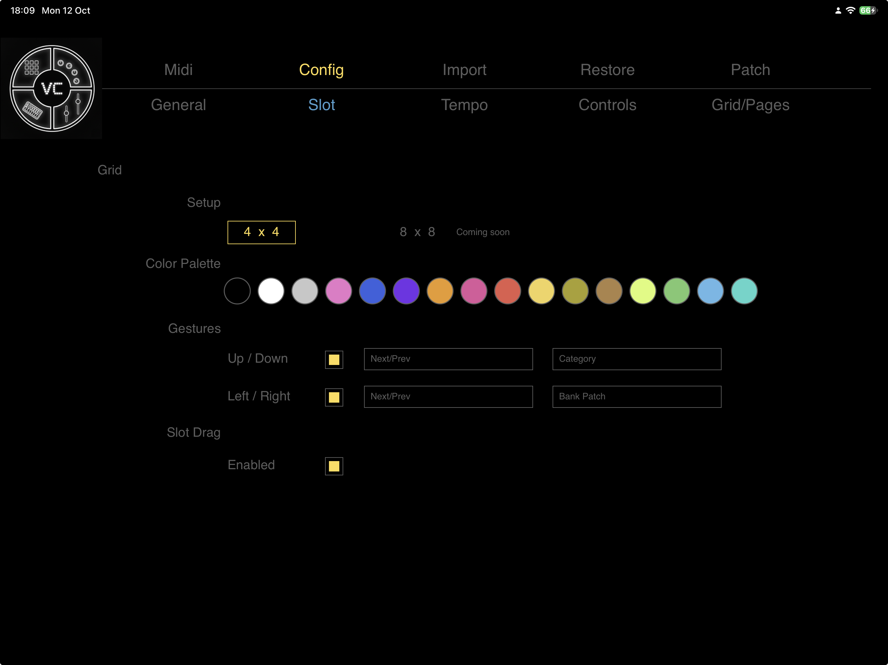

#### Tempo

**Tempo** controls the tempo modal. Enable the modal, show or hide presets, choose **Keypad** or **Encoder** entry, and enable fine tuning. Preset names and BPM values can be configured in the modal settings.

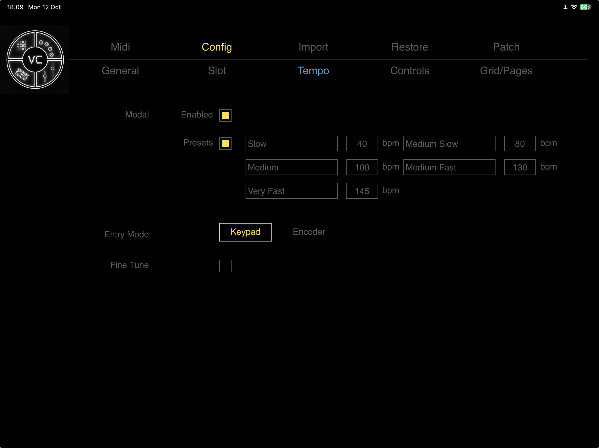

#### Controls

**Controls** determines which performance controls are shown in the Play view. Available controls include Drum, KARMA, SW1/SW2, Volume, EQ, and the small or full control groups for Master, Patch, and Drums.

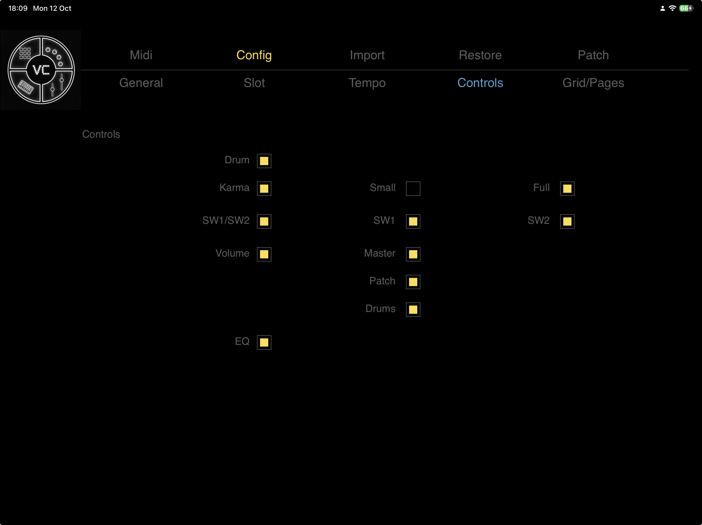

#### Grid/Pages

**Grid/Pages** sets the maximum number of PatchGrids, the maximum pages per PatchGrid, whether notes are enabled, and the maximum note length. It also enables template banks. Selecting an INT or USR bank creates template PatchGrids pre-filled with patches from that bank when the M3 patch list is available.

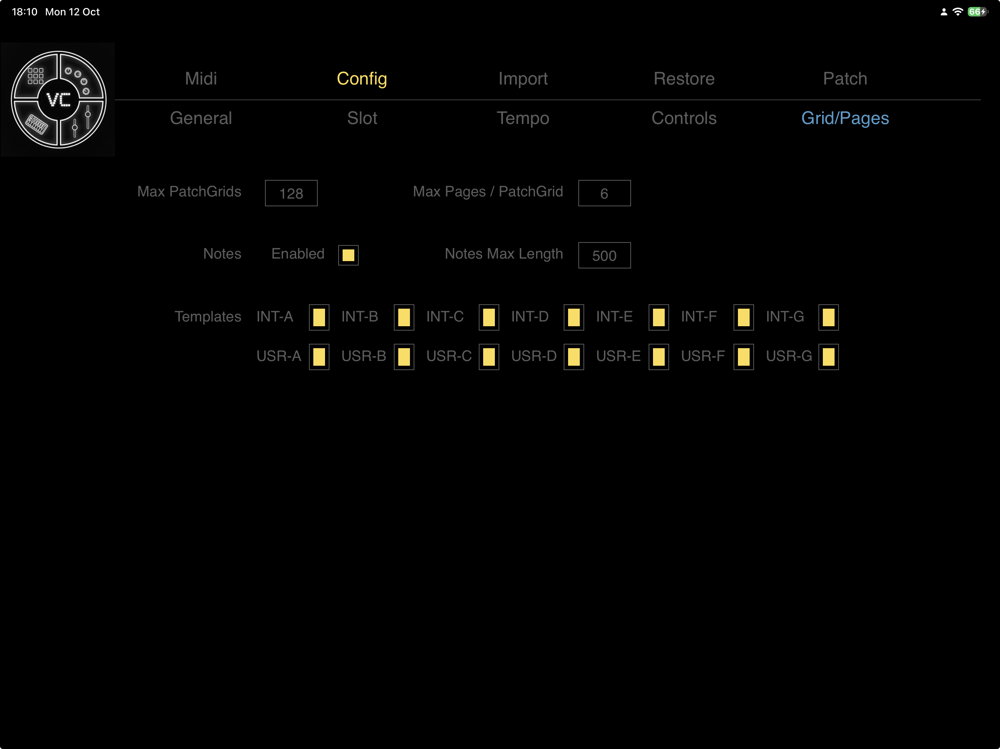

### Patch settings

#### Library / Assign

Open **Settings > Patch > Library** to assign imported patches to the M3 bank and patch positions recorded in PG. Libraries come from the **Import** (SysEx) or **PCG** menus. Importing stores the patch data; assigning tells PG where those sounds belong in the M3 patch selection.

1. Select the library imported through the **Import** (SysEx) or **PCG** menu.
2. Select the **COMBI** or **PROG** patches to assign.
3. Select the **M3 patch destination**: INT or USR, the bank, and the patch number as appropriate.
4. Click **+ADD** to add the selection to the assignment review for synchronising PG with the imported M3 patch data.
5. Review the source and target rows, then click **ASSIGN** to save the assignments.

**+ADD prepares the list; ASSIGN commits it.** Match the destinations to the patch locations already loaded on your M3. Library assignment updates PG's patch records; it does not upload the imported sounds to the instrument.

##### Import from the M3

Use **Import** to read patch data from the connected M3 into the application's patch storage.

1. Open **Settings** (Gear icon) and choose **Import**.
2. In the Import view, choose the patch type and the banks, categories, sub-categories, or patches to read.
3. Click **Start** to begin the MIDI extraction.
4. Wait for extraction to finish before returning to PatchGrid.

Import is the device-connected workflow. It sends requests to the M3 and stores the returned Program, Combination, or GM patch data. Use **Cancel** while an extraction is in progress if you need to stop it.

**Why include PROG with COMBI?** A COMBI refers to the Programs used by its timbres; the COMBI data alone do not contain those Program sounds. Importing the matching PROG data gives PG the information needed to resolve those timbres. Choose **Import All PROG** for a wider COMBI/PROG library, or **Import Required PROG** for only the selected Combis' required Programs. Leaving both options off imports no accompanying Programs.

##### Import (SysEx): COMBI with all PROG

Connect to the M3, then open **Settings > Patch > Import**. Choose **COMBI** and select the required patches or banks; use **All** for the full COMBI selection. Choose **Import All PROG** to read the accompanying Program set from the device, then click **Start**.

Keep the M3 connected while the patch counter and progress bar advance. **CANCEL** stops an import in progress. When finished, open **Library / Assign** to map the imported COMBI and PROG data to the locations used on your M3.

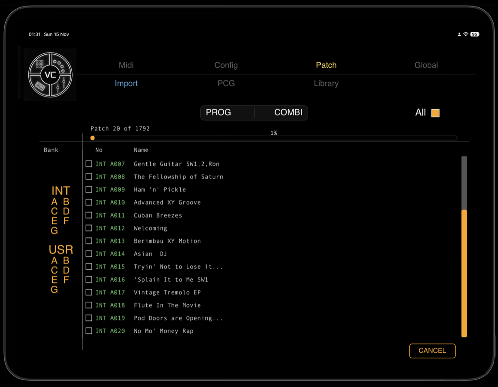

SysEx import from the connected M3. The patch counter and progress bar show the transfer in progress.

##### PCG import: COMBI with all PROG

Open **Settings > Patch > PCG**, click **Load**, and choose a compatible M3 PCG file containing both COMBI and PROG data. Select the Combis to import, or use **Select All** for the displayed selection. After loading the file, choose **Import All PROG** to include all eligible, visible Programs in that PCG, then start the import.

PG analyses the file and resolves Combination dependencies, as shown below. It cannot import Program data that are absent from the PCG. Check **Hide Init Patches** if you intend to exclude initialised patches; leave it off if those patches must also be included. After import, use **Library / Assign** to synchronise PG's patch positions.

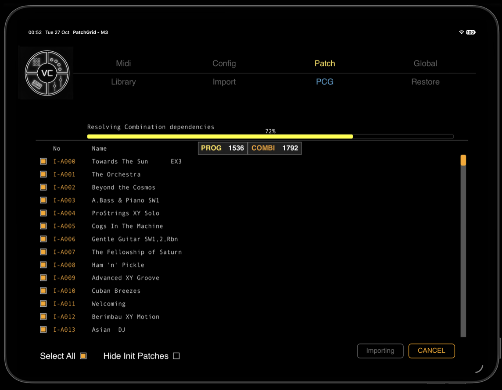

PCG import. PG resolves Combination dependencies before completing the import; the example shows both PROG and COMBI data.

##### Assign a complete COMBI and PROG set

Select the imported PCG library, then use **+ALL** in the COMBI section. PG also selects PROG +ALL so the combined set is included. Add it to the review and check the source and target summaries before clicking **ASSIGN**.

The example shows **All Combi (7 banks)** and **All Prog (7 banks)** assigned to Internal **A-G**. It illustrates the complete seven-bank COMBI/PROG selection, rather than assigning each patch separately. Wait for the progress bar to finish; **CANCEL** is available while assignment is running.

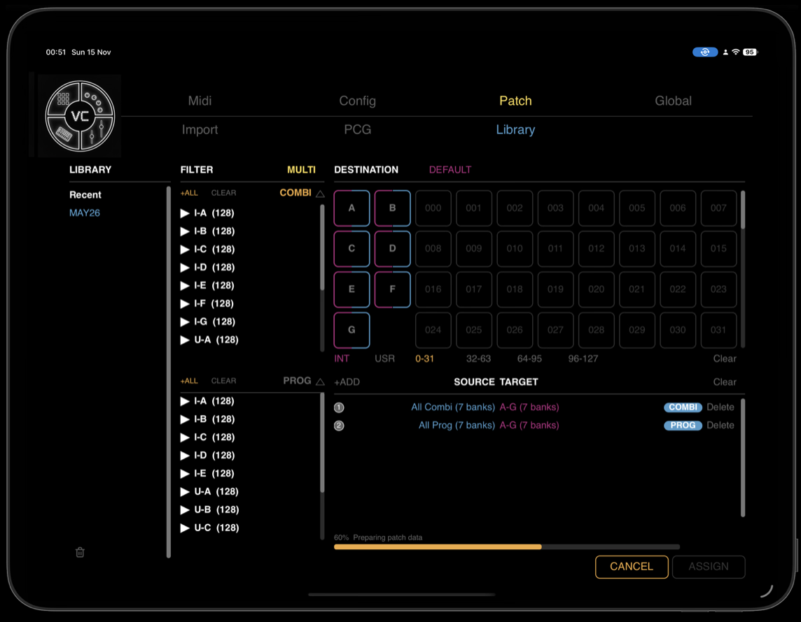

Complete-set assignment. The COMBI and PROG summaries cover seven Internal banks A-G; the example is preparing the patch data.

##### Assign one COMBI with its timbre programs

Expand a COMBI bank and select the required Combination. Choose its destination bank and patch number, then click **+ADD**. Expand the pending COMBI row to review the dependent programs shown as **TIMBRE** rows.

Click **ASSIGN** to include the COMBI and its required available timbre programs in PG's assignments. Check their source and target positions as well as the COMBI destination. Missing or invalid dependencies must be resolved; a broken COMBI is not silently assigned as a complete sound.

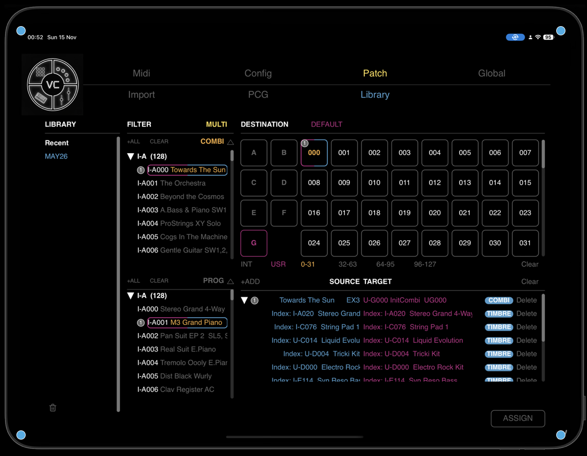

Single-COMBI assignment. Towards The Sun targets U-G000, with its dependent timbre programs listed below for review.

### Global

Open **Settings > Global** to access **Basic**, **Audio**, **Category**, and **SubCategory**. Basic and Audio share an editable set of Global settings. A connected M3 and complete Global data are needed to apply changes. These are instrument-wide settings, separate from the controls saved with an individual PatchGrid slot.

#### Apply changes to the M3

1. Connect to the M3 using the correct MIDI input and output.
2. Adjust the required controls in **Basic** and/or **Audio**.
3. Tap **APPLY** at the bottom-right of either screen to send the combined Basic and Audio edits to the M3.
4. Wait while the button shows orange **BUSY**. Green **DONE** indicates that the M3 acknowledged the transfer. Red **FAILED** indicates a rejected, unsuccessful, or timed-out transfer; check the connection and retry.

The Apply control is dimmed when the M3 is disconnected. If Global data are unavailable, allow the app to receive them from the M3 before retrying. Changing a staged control alone does not send that change to the instrument.

#### Immediate effect switches

**IFX**, **MFX**, and **TFX** under **Effect Global SW** take effect immediately on a connected M3. They do not require APPLY. IFX toggles the insert-effect group; MFX toggles the master-effect group; TFX toggles the total effect. If any effect in an IFX or MFX group is enabled, tapping the group disables it; tapping a fully disabled group enables it.

Tap the **Effect Global SW** heading to disable all three effect groups together. Tap it again to restore their previous states. These switches are live, so their changes are not waiting for APPLY.

#### Category and SubCategory

**Category** displays the loaded PROG or COMBI category names. **SubCategory** displays the sub-categories for the selected parent category. Choose the patch type and parent category to browse the corresponding list. These views browse existing names; they do not edit names or send changes with APPLY.

#### Basic

**Master Tune** adjusts tuning from -50 to +50 cents and displays the corresponding reference frequency. **Transpose** adjusts the global transposition from -12 to +12 semitones. Drag these knobs vertically.

Choose **Velocity Curve 1-9**, **Aftertouch Curve 1-8**, and **Pre-Midi** or **Post-Midi** for Convert Position. Tap **APPLY** to send these staged changes. The IFX, MFX, and TFX switches on this screen are the immediate-action exception described above.

**Current limitation - Master Volume:** the 0-127 slider is displayed and its value is saved in PatchGrid, but this build does not send that value to the M3 in the Global Apply transfer. Do not rely on this slider to change the instrument's volume.

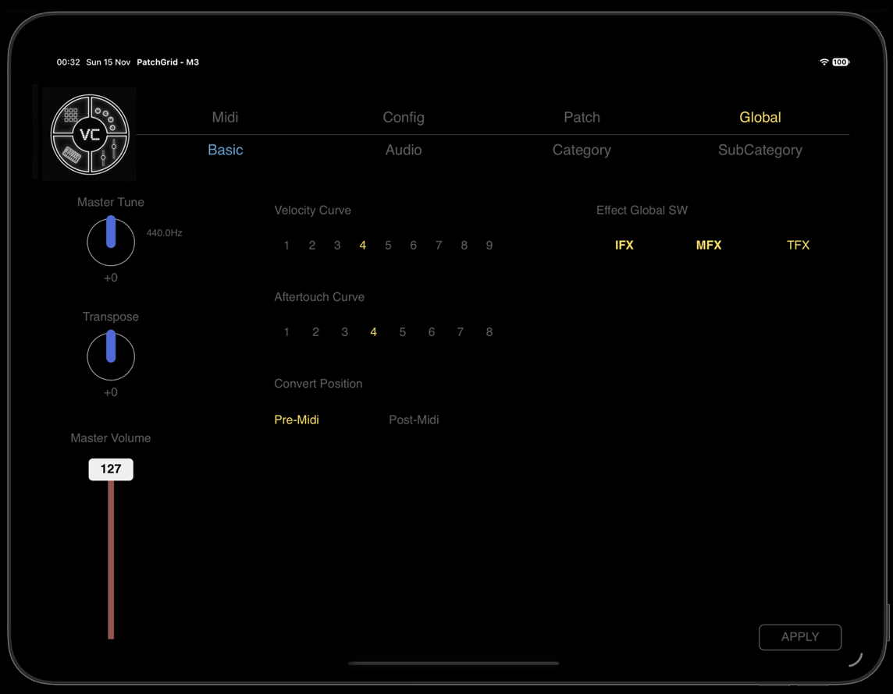

Global Basic. Use APPLY for tuning, transpose, curve, and conversion edits. IFX, MFX, and TFX act immediately.

#### Audio

Choose **Analog 1/2** or **SPDIF 1/2** as the input source, and **L/R**, **1/2**, or **3/4** as the output destination. Each selection replaces the previous choice in its group.

For **INPUT 1** and **INPUT 2**, adjust the upper **LEVEL** knob, the lower pan knob, and **SEND 1** and **SEND 2**. Levels and sends use 0-127. Choose the main **BUS** from Off, L/R, IFX 1-5, individual outputs 1-4, or paired outputs 1/2 and 3/4. **FX BUS** and **AUX BUS** each offer Off, 1, or 2.

**PLAY** enables an input; turning it off mutes that input when applied. **SOLO** selects one input at a time and mutes the other when applied. Tap the active SOLO again to clear it.

**Tap APPLY after editing Audio, including PLAY and SOLO.** These controls are staged; they are not immediate effect switches. APPLY sends the Audio edits together with any pending Basic edits.

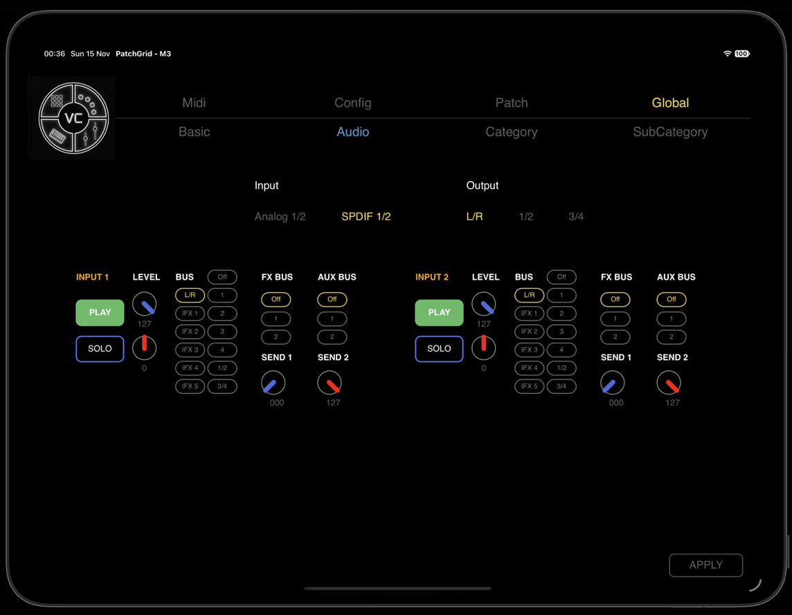

Global Audio. Select the source, output and routing for both inputs, then tap APPLY to set the changes on the M3.

### Leave the Settings view

Click the **Virtual Controller logo** on the left to leave Settings. The app returns to the PatchGrid view after the settings workflow closes.

## Saving and persistence

PatchGrid saves its data as it is changed. Assignments, page changes, slot controls, colours, notes, PatchGrid names, and page structure are persisted. Returning to **Play** also commits the current editing state and refreshes the PatchGrid list.

PatchGrid data is stored in the application's custom PatchGrid storage area. Do not edit the JSON files while PatchGrid is running.

## Troubleshooting

### A patch name is missing

Wait for patch loading to finish. PatchGrid requires both Program and Combination data before it can build the complete browser and Default PatchGrid.

### The M3 does not change sounds

Check that the correct MIDI output is selected, the M3 is connected, the MIDI channel matches, and the M3 is ready to receive bank and program changes.

### A new PatchGrid was not created

Check that the name is not empty, longer than 23 characters, duplicated, or a spelling variation of **Default PatchGrid**. Creation is confirmed only by Return or **Add**; losing focus does not create it.

### A delete or clear action did not happen

PatchGrid protects against accidental data loss. PatchGrid deletion and page deletion require a second click. The built-in Default PatchGrid and its first page have additional protection.

### I changed text and it reverted

Use **Save** for notes or Return/**Add** for a PatchGrid name. Escape or **Cancel** deliberately restores the previous value.

## Quick reference

| Task | Action |
| --- | --- |
| Select a patch | Play > click a filled slot |
| Move to another page | Click a page arrow |
| Re-order PatchGrids | Edit > tap PatchGrid reorder icon > drag selected PatchGrid |
| Re-order pages | Edit > tap Pages reorder icon > drag selected page |
| Search and assign a patch | Play > search icon > choose a result > assign to selected slot |
| Move slots | Play > unlock slot grid > drag a slot |
| Enable template PatchGrids | Settings > Config > Grid/Pages > enable INT or USR banks |
| Configure MIDI messages | Settings > MIDI > Bi-directional or Learn |
| Assign library patches | Settings > Patch > Library |
| Add a PatchGrid | Edit > New > name > Add or Return |
| Rename a PatchGrid | Edit > Rename or pencil > name > Add or Return |
| Add a page | Edit > Pages > New |
| Duplicate a page | Edit > Pages > Duplicate |
| Copy one slot | Select source > Copy > select target |

## Appendix A: Background Midi (iOS 26 or later)

Background MIDI is optional and is available on supported iPads running iPadOS 26 or later (the iPad operating system). It supports MIDI routing and instrument control while you use another app, including MIDI Router connections to external instruments when the M3 connection is skipped. It does not generate audio and does not guarantee uninterrupted background operation. On earlier iPadOS versions, these controls are not shown; use PatchGrid in the foreground.

> **Important - live performance:** PatchGrid's full functionality is available while the app remains in the foreground, subject to the required MIDI connections. Switching to another app may interrupt MIDI transmission between PatchGrid and the Korg M3 or external MIDI instruments, even with Background MIDI enabled. Interruptions may cause stuck notes that persist until PatchGrid returns to the foreground. Do not switch away from PatchGrid during live performance or whenever uninterrupted MIDI communication is critical.

### A.1 Enable Background MIDI at startup

On the Boot screen, select the **Background MIDI** checkbox beside **Connect**. The explanation shown below appears. Tap **OK** to close it; checking the box alone does not start a session. Then select **Connect** to use the M3, or choose **Skip M3 Connection** to continue without connecting the M3. Either action requests a background session when Background MIDI is checked. Skip retains separately configured keyboard inputs and MIDI Router routes to external instruments.

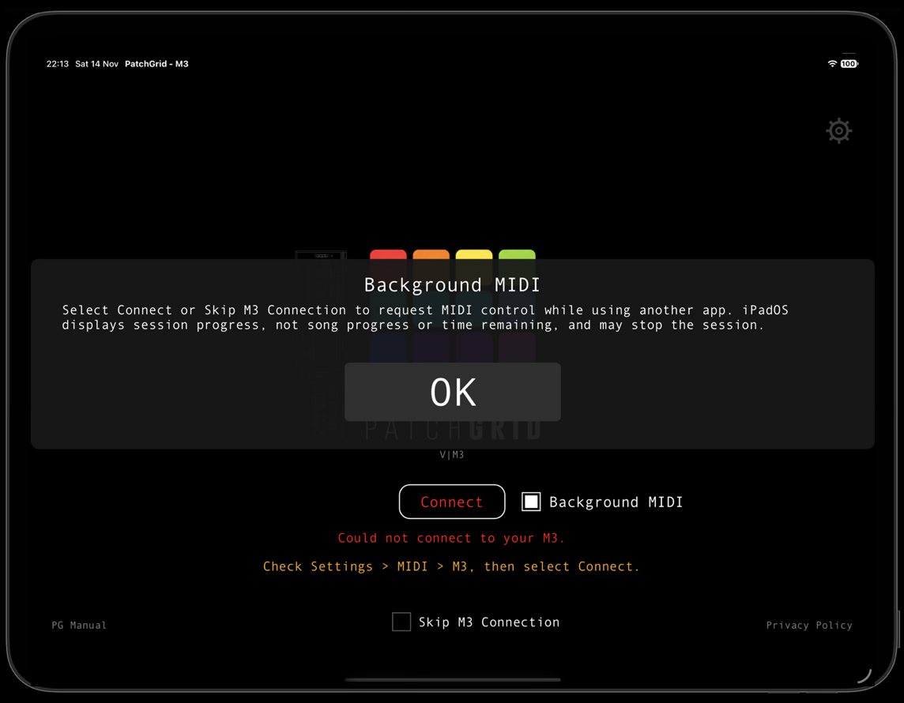

Boot explanation after selecting Background MIDI. Tap OK, then choose Connect or Skip M3 Connection.

### A.2 Understand the system notification

iPadOS displays its own Background MIDI session notification, separate from PatchGrid's InfoStrip. Session time refers to elapsed session time, not song progress or time remaining. iPadOS may refuse or end a session. Check the **Background MIDI InfoStrip**, beside the **MIDI InfoStrip**, for PatchGrid's current session status. An active session shows elapsed time.

In this screenshot, Apple's notification shows a session time and a check mark while PatchGrid's InfoStrip reads **STOPPED**. It illustrates the system notification, not confirmation that a session is still running. A notification alone does not prove that MIDI messages are being transmitted.

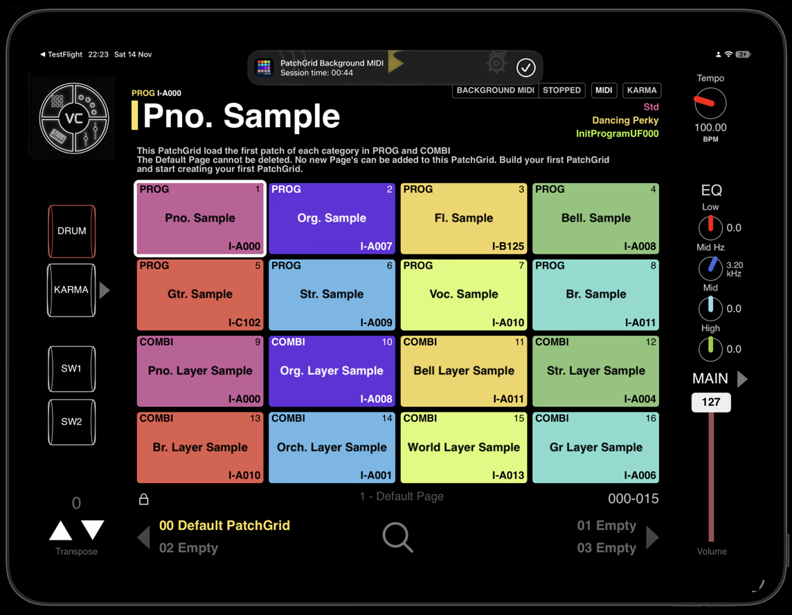

Apple's session notification. The PG InfoStrip reads STOPPED in this captured example.

### A.3 Stop a background session

While a session is active, tap the **Background MIDI InfoStrip** next to the **MIDI InfoStrip**. The dialog shows **Background MIDI active**. Tap **Stop Session** to end the background session, or **Cancel** to leave it running. Stopping the session does not disable normal foreground MIDI or close the configured MIDI ports. Keep PatchGrid in the foreground to continue using MIDI reliably.

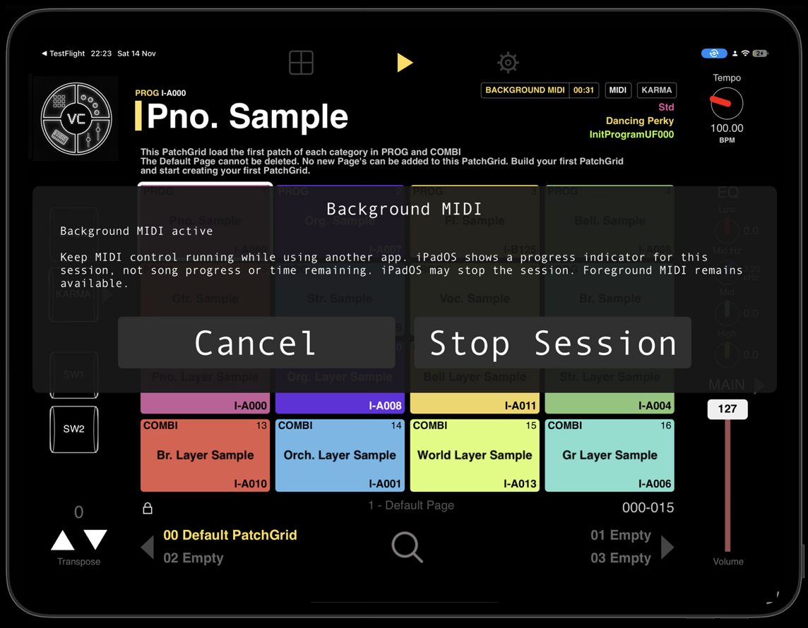

Tap the Background MIDI InfoStrip, then Stop Session. Cancel leaves the current session running.

### A.4 Start a session again

After a session has stopped, tap the **Background MIDI InfoStrip** again. The dialog shows the stopped status and offers **Start Session**. Tap **Start Session** to request a new background session, or **Cancel** to leave it stopped. The elapsed-time display starts when iPadOS accepts and launches the session. If the request is refused, keep PatchGrid in the foreground.

Sessions do not restart automatically after a user or system cancellation. Background MIDI is a per-launch choice; after closing and relaunching PatchGrid, enable it again if required. Session controls are also available from **Settings > Config > General > Background MIDI**.

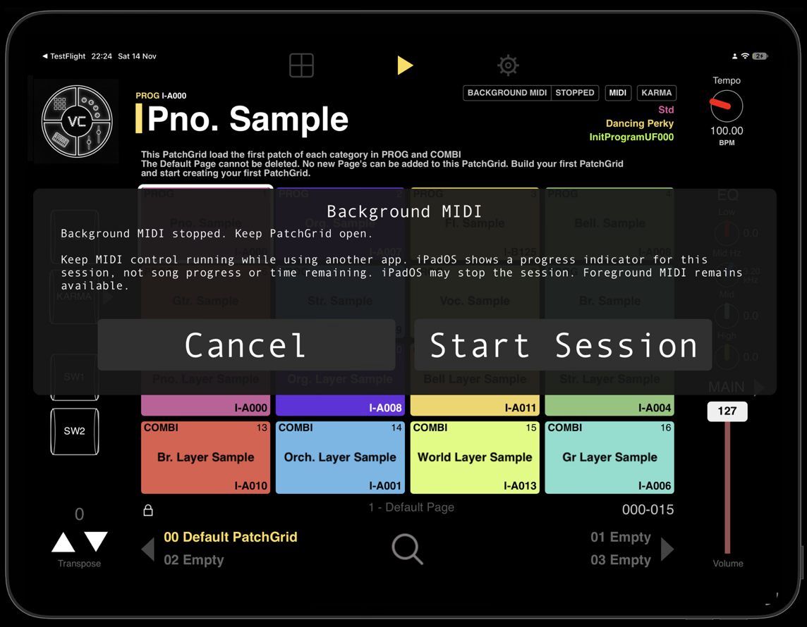

Tap Start Session to request background MIDI again. Cancel leaves the session stopped.

© 2026 Stringline Productions. All rights reserved.
